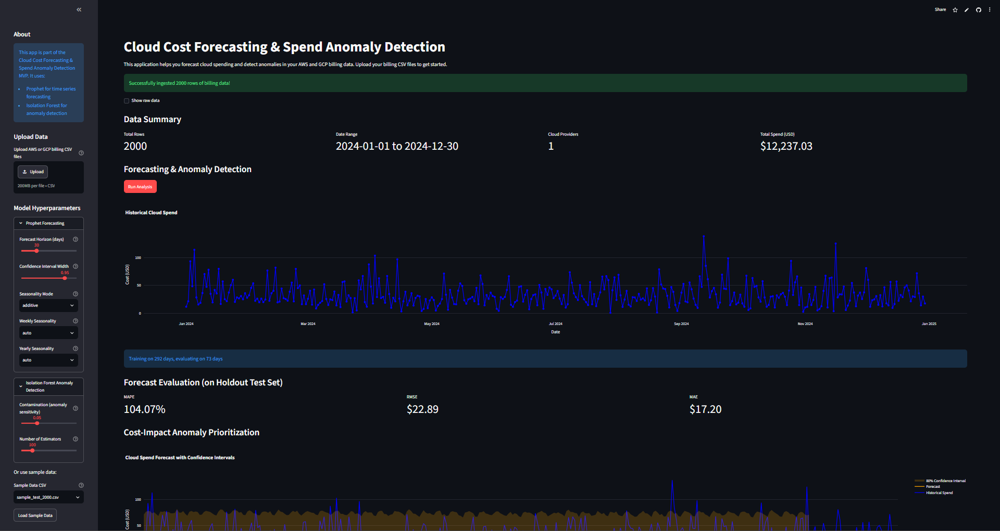

# FinOps — Cloud Cost Forecasting & Spend Anomaly Detection

An open-source, multi-cloud FinOps analytics platform for forecasting cloud spending and detecting spend anomalies with cost-impact-aware prioritization.


---

## Overview

**FinOps** is a complete, runnable FinOps pipeline that ingests AWS Cost & Usage Report (CUR) and GCP Billing Export CSV files, forecasts daily cloud spend with Prophet, detects anomalies on forecast residuals using Isolation Forest, and ranks anomalies by estimated dollar impact (not just statistical deviation).

The pipeline is: **ingest → forecast → detect → cost-impact rank → explain**.

- **Forecasting**: Facebook Prophet, chronological 80/20 train/test split, 80% confidence intervals, 7–30 day horizon.
- **Anomaly detection**: scikit-learn Isolation Forest on forecast residuals (test period only — no data leakage).
- **Cost-impact ranking**: Gated additive scoring that boosts anomalies with both statistical evidence and financial impact.
- **Explanations**: Deterministic, template-based per-anomaly explanations (observed vs expected, excess cost, rank).
- **Experiment tracking**: MLflow (local SQLite backend).
- **Dashboard**: Streamlit + Plotly interactive UI.

> **What this is**: an MVP validated on synthetic benchmarks with reproducible experiments and a passing test suite.
> **What this is not**: a production SaaS, an enterprise FinOps platform, or a claim of real-world cost savings. All published metrics come from a synthetic 180-day benchmark; real billing validation is pending.

---

## Live Dashboard

Explore the deployed application: [Launch FinOps Dashboard](https://finops-cloud-cost-forecast.streamlit.app/).



> The live app is hosted on Streamlit Cloud. MLflow local SQLite does not persist across Streamlit Cloud redeploys.

---

## Key Features

| Feature | Description |
|---------|-------------|
| Multi-cloud ingestion | AWS CUR + GCP Billing Export CSV → unified schema |
| Forecasting | Prophet, 80% confidence intervals, 7–30 day horizon |
| Anomaly detection | Isolation Forest on test-period forecast residuals |
| Cost-impact ranking | Gated additive scoring (`score + α·excess·confidence·gate`) |
| Explanations | Deterministic templates: observed vs expected, excess, rank |
| Experiment tracking | MLflow (local SQLite) |
| Interactive dashboard | Streamlit + Plotly forecasts, rankings, explanations |
| Reproducible experiments | 56 tests passing, pinned dependencies |

---

## Architecture and Data Flow

```
AWS CUR ─────┐
             ├─► Data Ingestion ──► Unified Schema (date, cloud_provider, service_name, account_id,
GCP Billing ─┘                          region, environment, usage_quantity, usage_unit, cost_usd)
                                         │
                                         ▼
                              Preprocessing (chronological sort, type coercion, validation)
                                         │
                                         ▼
                              Forecasting (Prophet; 80/20 chronological split;
                                           80% CI; 7–30 day horizon)
                                         │
                                         ▼
                              Anomaly Detection (Isolation Forest on test-period
                              residuals: residual, lag1, rolling 7-day mean/std)
                                         │
                                         ▼
                              Cost-Impact Ranking (gated additive: norm_score
                              + α·norm_excess_cost·confidence·gate)
                                         │
                                         ▼
                              Explanation Layer (deterministic templates)
                                         │
                                         ▼
                              Streamlit Dashboard (forecasts, anomalies, rankings,
                              explanations)
                                         │
                                         ▼
                              MLflow Tracking (params, metrics, artifacts)
```

### Module responsibilities

| Module | Responsibility |
|--------|----------------|
| `cloud-cost-forecasting/app/ingest/` | AWS CUR / GCP Billing Export → unified schema |
| `cloud-cost-forecasting/app/forecasting/` | Prophet wrapper: fit, predict, evaluate (MAE/RMSE/MAPE) |
| `cloud-cost-forecasting/app/anomaly/` | Isolation Forest detector + CostImpactScorer + AnomalyExplainer |
| `cloud-cost-forecasting/app/tracking/` | MLflow ExperimentTracker |
| `cloud-cost-forecasting/app/visualization/` | Plotly charts (historical, forecast+CI, anomalies, service spend, monthly trend) |
| `cloud-cost-forecasting/app.py` | Streamlit entrypoint wiring the full pipeline |
| `experiments/` | Benchmark data, baselines, experiment runner, result artifacts |

### AWS/GCP ingestion and unified schema

The ingestor auto-detects file format by column headers and normalizes both to the same schema:

| Source column (AWS CUR) | Source column (GCP Billing Export) | Unified column |
|-------------------------|-----------------------------------|----------------|
| `bill/BillingPeriodStartDate` | `usage_start_time` | `date` |
| `lineItem/ProductCode` | `service.description` | `service_name` |
| `lineItem/UsageAccountId` | `project.id` | `account_id` |
| `lineItem/UsageAmount` | `usage.amount` | `usage_quantity` |
| `lineItem/UnblendedCost` | `cost` | `cost_usd` |
| `product/region` | — | `region` |

Additional columns added: `cloud_provider` (`AWS`/`GCP`), `environment` (`"unknown"`), `usage_unit` (`"unknown"`). Output columns: `date, cloud_provider, service_name, account_id, region, environment, usage_quantity, usage_unit, cost_usd`.

Sample data: `cloud-cost-forecasting/data/samples/sample_aws_billing.csv` and `sample_gcp_billing.csv` (90 days / 360 rows per provider, synthetic).

---

## Forecasting Methodology

- **Model**: Facebook Prophet (`Prophet`), daily aggregated cost series (`date`, `cost_usd`).
- **Split**: Chronological 80/20 train/test (first 80% train, last 20% holdout). No random shuffling — prevents leakage.
- **Horizon**: 7–30 days, configurable via the Streamlit sidebar (default 30).
- **Confidence intervals**: 80% by default, configurable 0.80–0.99.
- **Seasonality**: weekly/yearly (`auto` by default); additive or multiplicative mode.
- **Evaluation**: MAE, RMSE, MAPE (zero actuals excluded), computed on the holdout test set via `sklearn.metrics`.
- **Rolling-origin validation** (offline experiments only): 12 folds × 2 providers, 90-day initial train, 7-day horizon, 7-day step.

Prophet is the only forecasting model implemented; no ARIMA/SARIMA fallback.

---

## Anomaly Detection Methodology

- **Input**: Forecast residuals on the test period: `residual = actual − predicted`.
- **Features** (4-dimensional): `residual`, `residual_lag1`, `residual_rolling_mean_7`, `residual_rolling_std_7`. Missing values handled with `bfill().ffill()`.
- **Model**: scikit-learn `IsolationForest` fitted on test-period residuals only (no leakage — training residuals are not used for fitting; test residuals are scored by the fitted detector).
- **Configuration**: `contamination=0.05`, `n_estimators=100`, `random_state=42`, `max_features=1.0`, `bootstrap=False`.
- **Labels**: `-1` anomaly / `1` normal.
- **Configurable via UI**: contamination (0.01–0.15), n_estimators (50–300).

---

## Cost-Aware Prioritization (Project Contribution)

### The problem

Ranking purely by statistical deviation (Isolation Forest score) misaligns with FinOps reality: a small anomaly in a low-spend service can outrank a large-cost surge in a critical service. FinOps teams need to prioritize by estimated **dollar impact**.

### The solution

A **gated additive** cost-impact score:

```
cost_impact = norm_score + α × norm_excess_cost × confidence × gate
```

where:

- `norm_score` = normalized anomaly magnitude [0, 1]
- `norm_excess_cost` = normalized `max(observed − expected, 0)` [0, 1]
- `confidence` = `1 − MAPE` clipped to [0, 1]
- `gate` = `1` if `norm_score > gate_threshold` (default 0.5) else `0`
- `α` = 0.5

**Why gated additive**: A pure multiplicative form (`score × cost × confidence`) over-ranks high-cost normal days when anomaly evidence is weak. The gate ensures cost-weighting only activates when there is sufficient anomaly evidence, preventing high-cost normal days from dominating the ranking.

**Default hyperparameters** (`CostImpactScorer`): `alpha=0.5`, `gate_threshold=0.5`, `confidence_weight=1.0`, `cost_weight=1.0`, `score_weight=1.0`, `min_excess_cost=0.01`.

The ranking table shows only confirmed anomalies (`anomaly_label == 1`), ranked by `cost_impact_score`, with severity badge (`HIGH` for anomalies, `Normal` otherwise).

---

## Explainability

`AnomalyExplainer` generates deterministic, template-based explanations per anomaly using only observable data:

- Observed vs expected cost, excess amount, relative deviation
- Anomaly score and cost-impact score
- Priority rank and cumulative excess cost over the anomaly period
- Severity tier

No SHAP, no causal inference, no fabricated root causes — explanations report what the data shows. The explanation layer is unit-tested for determinism (identical input → identical output).

---

## Verified Experimental Results (Synthetic Benchmark)

All results below come from the **180-day synthetic benchmark** (Jan 1 – Jun 28, 2024, seed=42), **not** real AWS/GCP billing data. `experiments/data/benchmark_metadata.json` explicitly states `data_type: SYNTHETIC_BENCHMARK`.

### Forecasting — rolling-origin, 12 folds × 2 providers

| Model | AWS MAE | AWS MAPE | GCP MAE | GCP MAPE |
|-------|--------:|---------:|--------:|---------:|
| Prophet | 23.66 | 4.6% | 24.07 | 5.6% |
| MA(14) | 41.26 | 7.97% | 35.57 | 8.16% |
| MA(7) | 42.67 | 8.29% | 34.58 | 8.02% |
| MA(30) | 41.79 | 7.90% | 37.43 | 8.38% |
| Naive | 65.31 | 12.57% | 50.22 | 11.08% |

Prophet consistently outperforms all baselines on both providers.

### Anomaly detection — 70/30 split, ground-truth synthetic anomalies

| Method | AWS PR-AUC | GCP PR-AUC |
|--------|-----------:|-----------:|
| Threshold | 0.018 | 0.130 |
| RawCost_IF | 0.792 | 0.283 |
| Residual_IF | 0.417 | 0.258 |
| **CostAware_IF (gated additive)** | **1.000** | **0.300** |

Cost-aware ranking resolves AWS degradation (0.792 → 1.000) while maintaining GCP performance (0.283 → 0.300). All 3 true AWS anomalies ranked top-3.

### Cost@K — cumulative excess cost captured in Top-K

**AWS** (total excess $462.65, 3 true anomalies):

| K | Captured excess | Capture rate | Anomalies captured |
|---|----------------:|-------------:|-------------------:|
| 1 | $90.32 | 19.5% | 1/3 (33%) |
| 3 | $182.44 | 39.4% | 3/3 (100%) |
| 5 | $182.44 | 39.4% | 3/3 (100%) |
| 10 | $206.62 | 44.7% | 3/3 (100%) |

**GCP** (total excess $575.37, 3 true anomalies in test period):

| K | Captured excess | Capture rate | Anomalies captured |
|---|----------------:|-------------:|-------------------:|
| 1 | $56.42 | 9.8% | 1/3 (33%) |
| 3 | $82.17 | 14.3% | 2/3 (67%) |
| 5 | $86.05 | 15.0% | 3/3 (100%) |
| 10 | $96.59 | 16.8% | 3/3 (100%) |

> These Cost@K figures were independently recomputed from `experiments/results/anomaly_ranking_{AWS,GCP}.csv`. They differ from some copied figures in `docs/EXPERIMENTAL_VALIDATION.md` (which incorrectly duplicates AWS Cost@3 for GCP). The README uses the recomputed, verified values.

### Caveats

- Results are on **synthetic data only**; real billing validation is pending.
- AWS test period has only 3 true anomalies — statistical significance is limited.
- GCP recall is low for all methods (9 of 10 anomalies missed).
- No real cost savings have been measured; synthetic excess cost ≠ real savings.

---

## Technology Stack

| Layer | Technology |
|-------|------------|
| Language | Python 3.10+ (runtime: 3.11) |
| Forecasting | Prophet 1.3+ |
| Anomaly detection | scikit-learn 1.4+ (Isolation Forest) |
| Explanations | Deterministic templates (no SHAP) |
| Experiment tracking | MLflow 2.12+ (local SQLite) |
| Dashboard | Streamlit 1.35+ / Plotly 5.20+ |
| Data processing | pandas 2.2+, NumPy 1.26+ |
| Web compatibility | starlette<1.8.0 |
| Serialization | protobuf>=3.20.0,<5.0.0 |

Pinned dependencies live in `cloud-cost-forecasting/requirements.txt`. A duplicate root `requirements.txt` exists with identical contents.

---

## Repository Structure

```
FinOps/
├── README.md                      # this file
├── requirements.txt               # pinned dependencies (root copy)
├── .gitignore
├── .streamlit/config.toml         # Streamlit server config (root copy)
├── .github/workflows/ci.yml       # CI: Python 3.11, pytest on master
├── .devcontainer/devcontainer.json
├── cloud-cost-forecasting/
│   ├── app.py                     # Streamlit entrypoint
│   ├── requirements.txt           # pinned dependencies (app copy)
│   ├── runtime.txt                # python-3.11
│   ├── .streamlit/config.toml     # Streamlit config (app copy)
│   ├── mlflow.db                  # local MLflow SQLite (gitignored)
│   ├── app/
│   │   ├── __init__.py
│   │   ├── ingest/
│   │   │   ├── __init__.py, ingestor.py, schema.py
│   │   ├── forecasting/
│   │   │   ├── __init__.py, prophet_model.py
│   │   ├── anomaly/
│   │   │   ├── __init__.py, isolation_forest.py, cost_aware.py, explanations.py
│   │   ├── tracking/
│   │   │   ├── __init__.py, tracker.py
│   │   └── visualization/
│   │       ├── __init__.py, plots.py
│   ├── data/samples/
│   │   ├── sample_aws_billing.csv     # 90 days, synthetic
│   │   ├── sample_gcp_billing.csv     # 90 days, synthetic
│   │   ├── sample_test_1000.csv
│   │   └── sample_test_2000.csv
│   └── tests/
│       ├── __pycache__
│       └── test_ingestor.py         # 12 tests
├── experiments/
│   ├── run_experiments.py         # full experiment runner
│   ├── forecasting/baselines.py   # Naive, MA(7/14/30), Prophet, rolling-origin
│   ├── anomaly/
│   │   ├── baselines.py           # Threshold, RawCost_IF, Residual_IF
│   │   ├── cost_aware.py          # CostImpactScorer, run_cost_aware_comparison
│   │   └── explanations.py        # AnomalyExplainer
│   ├── data/
│   │   ├── synthetic_benchmark.csv
│   │   ├── synthetic_benchmark_detailed.csv
│   │   ├── ground_truth_anomalies.csv   # 7 events, 38 anomaly days
│   │   ├── benchmark_metadata.json      # seed=42, SYNTHETIC_BENCHMARK
│   │   └── generate_synthetic_benchmark.py
│   ├── results/                   # CSV/JSON experiment outputs
│   │   ├── forecast_*.csv
│   │   ├── anomaly_comparison_*.csv
│   │   ├── anomaly_ranking_*.csv
│   │   ├── experiment_summary.json
│   │   └── cost_aware_baseline.json
│   └── plots/                     # (empty)
├── tests/
│   ├── conftest.py
│   ├── test_explanations.py       # 11 tests
│   ├── test_file_loading.py       # 9 tests
│   └── test_pipeline.py           # 24 tests
├── docs/
│   ├── architecture/ARCHITECTURE.md
│   ├── architecture/DATA_FLOW.md
│   ├── ML_METHODOLOGY.md
│   ├── EXPERIMENTAL_VALIDATION.md
│   ├── FEATURES.md
│   ├── decisions/ADR-0001-project-structure.md
│   ├── images/dashboard_finops.png
│   ├── research/                  # 15 research reports
│   └── PRODUCTION_CORRECTNESS_AUDIT.md, RECOVERY_PLAN.md, etc.
├── scripts/run-tests.ps1, scripts/validate.ps1
└── mlruns/                        # MLflow artifact store (gitignored)
```

---

## Installation and Quick Start

### Prerequisites
- Python 3.10+
- `pip` / `venv`

### Install

```bash
# Clone
git clone https://github.com/Aathish14/FinOps.git
cd FinOps

# Create virtual environment
python -m venv .venv
# Windows: .venv\Scripts\activate
source .venv/bin/activate

# Install dependencies (pinned)
pip install -r cloud-cost-forecasting/requirements.txt
pip install pytest
```

### Run locally

```bash
cd cloud-cost-forecasting
streamlit run app.py
# Opens http://localhost:8501
```

### With MLflow UI

```bash
mlflow ui   # http://localhost:5000
```

### Run tests

Root suite (44 tests):
```bash
python -m pytest tests/ -v
```

App suite (12 tests):
```bash
cd cloud-cost-forecasting
python -m pytest tests/ -v
```

All 56 tests pass.

---

## Application Usage

1. **Load data**: Click "Load Sample Data" in the sidebar (selects a sample CSV from `data/samples/`), or upload your own AWS CUR / GCP Billing Export CSV files via the file uploader.
2. **Configure model** (sidebar): set forecast horizon (7–30 days, default 30), confidence interval width, seasonality mode, Isolation Forest contamination (default 0.05), n_estimators (default 100).
3. **Run Analysis**: the app aggregates daily spend, splits 80/20 chronologically, fits Prophet, evaluates on the holdout set, runs anomaly detection on test residuals, and ranks anomalies by cost-impact.
4. **Review outputs**: forecast chart with 80% CI, MAPE/RMSE/MAE metrics, cost-impact ranked anomaly table, per-anomaly explanations, spending-by-service and monthly-trend charts.
5. **MLflow**: each analysis starts a run (`forecasting_analysis_<timestamp>`) logging params and metrics; view with `mlflow ui`.

Minimum data requirements: ≥30 daily observations for forecasting, ≥10 training residuals for anomaly detection. Forecast horizon capped at 50% of history length.

---

## Testing and Reproducibility

- **56 tests total** pass: 44 root (`tests/`) + 12 app (`cloud-cost-forecasting/tests/`).
- Coverage: ingestion (AWS/GCP/multi-file), file-input normalization, Prophet fit/predict/evaluate, timezone handling, Isolation Forest fit/predict, cost-impact ranking table (anomalies only), explanation layer (determinism, UI formatting, batch explanations).
- Determinism: `np.random.seed(42)`, `random_state=42`, fixed chronological splits, fixed synthetic benchmark generation (seed=42).
- Static analysis: `python -m compileall cloud-cost-forecasting/app/` and `pyflakes` clean.

### CI

`.github/workflows/ci.yml` runs on push/PR to `master`: Python 3.11, installs `cloud-cost-forecasting/requirements.txt` + pytest, runs `pytest tests/` in `cloud-cost-forecasting/` and the root `tests/`.

---

## Configuration and Deployment

### Configuration

`cloud-cost-forecasting/.streamlit/config.toml` (and root copy):

```toml
[server]
headless = true
port = 8501
enableCORS = true
enableXsrfProtection = true

[browser]
gatherUsageStats = false
```

### Environment variables

| Variable | Purpose | Default |
|----------|---------|---------|
| `MLFLOW_TRACKING_URI` | MLflow backend URI | `sqlite:///mlflow.db` (local) |
| `MLFLOW_EXPERIMENT_NAME` | Experiment name | `cloud_cost_forecasting` |

No secrets are stored in code; `.env` is gitignored.

### Deployment

**Streamlit Cloud**: connect the repo, set entrypoint to `cloud-cost-forecasting/app.py`. Note: MLflow local SQLite does not persist across Streamlit Cloud redeploys; for production use a managed MLflow server. The repository's default branch is `master`, not `main` — update Streamlit Cloud settings accordingly.

**Local**: `streamlit run app.py` + `mlflow ui`.

> Deployment is not verified; the Streamlit Cloud URL is retained as supplied but uptime was not confirmed during this review.

---

## Limitations and Realistic Future Work

| Limitation | Detail |
|------------|--------|
| Synthetic benchmark only | All published metrics come from synthetic data; real billing validation pending |
| Small AWS anomaly sample | Only 3 true anomalies in test period; statistical significance limited |
| GCP recall low | All methods miss most GCP anomalies |
| Sample data sufficient | `data/samples/` has 90 days per provider (adequate for the app) |
| No SHAP | Explanations are template-based, not model-internals-based |
| Single-series forecasting | Aggregates all services per day; per-service detection not implemented |
| MLflow local-only | Local SQLite; cloud deployment needs a managed tracking server |
| No authentication/RBAC | Designed for internal use |
| No CI/CD beyond tests | GitHub Actions runs tests only |
| No real cost savings measured | Synthetic excess cost ≠ real savings |
| No production-readiness claim | MVP; not an enterprise FinOps platform |

**Realistic future work** (not yet implemented):
- Real cloud billing validation (partner dataset or public CUR/GCP exports)
- Per-service anomaly detection
- Expected-change classification (correlate anomalies with CI/CD deployments)
- Managed MLflow for cloud deployment
- Authentication and multi-tenancy

---

## Contributing

1. Fork the repository and create a feature branch from `master`.
2. Reproduce issues locally: `pip install -r cloud-cost-forecasting/requirements.txt pytest` and run both test suites.
3. Add or update tests under `tests/` (root) or `cloud-cost-forecasting/tests/` (app).
4. Keep changes minimal and consistent with existing module structure (`app/ingest/`, `app/forecasting/`, `app/anomaly/`, `app/tracking/`, `app/visualization/`).
5. Do not claim novelty, production readiness, or real-world performance without experimental evidence.
6. Open a pull request against `master`.

---

## Further Documentation

| Document | Purpose |
|----------|---------|
| `docs/architecture/ARCHITECTURE.md` | Pipeline diagram, module responsibilities |
| `docs/architecture/DATA_FLOW.md` | End-to-end data flow based on `app.py` |
| `docs/ML_METHODOLOGY.md` | Models, baselines, evaluation, formulation |
| `docs/EXPERIMENTAL_VALIDATION.md` | 180-day benchmark, rolling-origin, ablation |
| `docs/FEATURES.md` | Buyer-facing feature matrix |
| `docs/research/` | 14 research reports (novelty decision, gap analysis, prior art, phase reports) |
| `cloud-cost-forecasting/app/` source | Authoritative implementation |

---

## License and Acknowledgements

No LICENSE file exists in the repository root. The existing README references MIT, but this has not been verified against an actual license file. Add a `LICENSE` file before distributing.

### Acknowledgements

- [Prophet](https://facebook.github.io/prophet/) — time series forecasting
- [scikit-learn](https://scikit-learn.org/) — Isolation Forest
- [MLflow](https://mlflow.org/) — experiment tracking
- [Streamlit](https://streamlit.io/) — web app framework
- [Plotly](https://plotly.com/) — interactive visualizations

---

## Support

For questions, issues, or commercial inquiries:
- GitHub Issues: [github.com/Aathish14/FinOps/issues](https://github.com/Aathish14/FinOps/issues)

---

*FinOps — Making cloud costs predictable, anomalies explainable, and financial impact actionable. MVP validated on synthetic benchmarks; real-world validation pending.*
